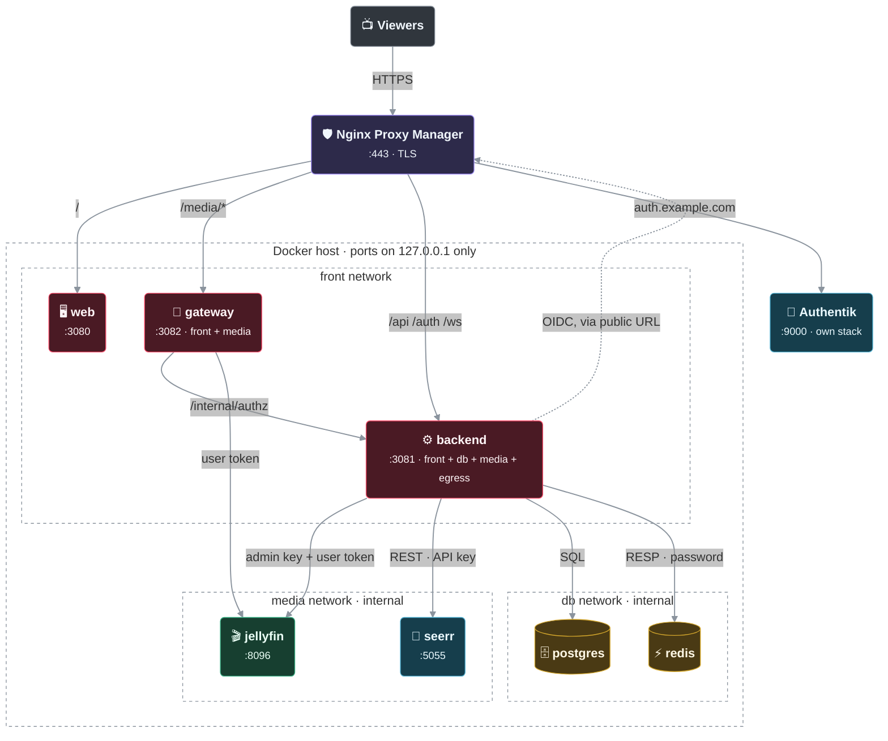
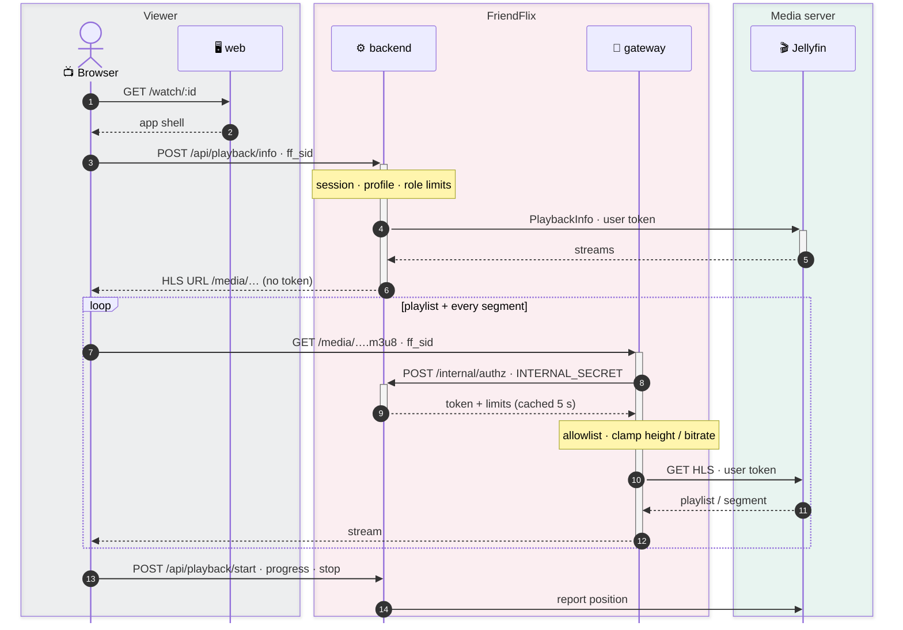
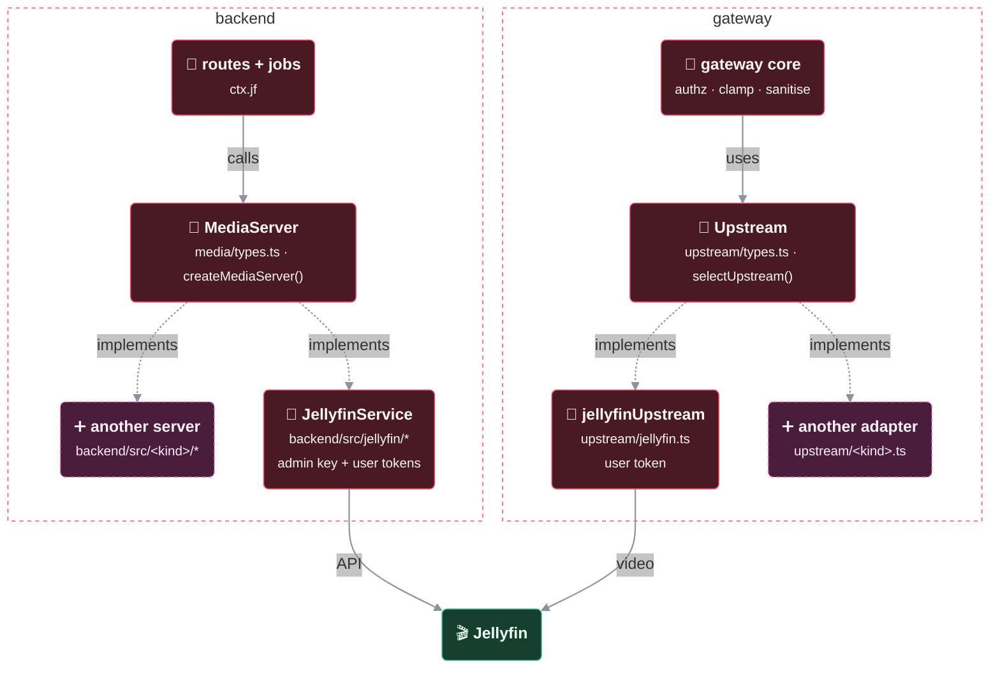

# Architecture notes

## Containers and networks

Who talks to whom, and on which Docker network. Only the reverse proxy is public; every published port is bound to `127.0.0.1`.

> 🟥 FriendFlix · 🟩 media server · 🟦 other service · 🟪 reverse proxy · 🟨 data store · ⬛ viewers / outside · dashed frame = network or boundary · thick line = video stream · dotted = optional / via public URL

| Service | Networks | Host port (127.0.0.1) | Holds |
|---|---|---|---|
| web | front | 3080 | nothing secret |
| backend | front, db, media, egress | 3081 | `APP_ENC_KEY`, `INTERNAL_SECRET`, Jellyfin admin API key, OIDC client secret; sessions (cookie `ff_sid`) in Redis; per-user Jellyfin credentials encrypted in Postgres |
| gateway | front, media | 3082 | `INTERNAL_SECRET`; gets the user's media token per request from the backend (cached 5 s), never stores it |
| postgres, redis | db (internal) | none | accounts, profiles, sessions |
| jellyfin, seerr (profile `bundled`) | media (+egress) | none | media, request data |
| Authentik (`compose.authentik.yaml`) | front, ak-db, egress | 9000 | identities |

The browser only ever sees a session cookie and `/media/...` URLs, never a Jellyfin token.

Media tokens never leave the server: the browser holds a session cookie and plays `/media/...` URLs that only the gateway can resolve. Alternative setups (Plan B, bundled Jellyfin, Authentik in its own stack): [operations.md](operations.md), [setup.md](setup.md).

## Press play

What happens between the play button and the first picture. Every playlist and every segment passes the gateway, which asks the backend what this session may do (`/internal/authz`: token and limits, cached for 5 seconds) before it clamps height and bitrate and fetches from the media server with the user's token.

## Media server seam

FriendFlix talks to its media server through one neutral interface. Today the only implementation is Jellyfin; the seam exists so that another server (a fork adds Plex, for example) can be added mostly by **adding** files instead of editing shared ones.

How the pieces line up: backend routes and jobs only know the `MediaServer` interface, the gateway core only the `Upstream` adapter; each media server kind provides one of each, and `MEDIA_SERVER` picks them.

> 🟥 FriendFlix · 🟩 media server · 🟦 other service · 🟪 reverse proxy · 🟨 data store · ⬛ viewers / outside · 🟫 dashed pink = room for another media server · dashed frame = network or boundary · thick line = video stream · dotted = optional / via public URL

### Backend

| File | Role |
|---|---|
| `backend/src/media/types.ts` | The `MediaServer` interface, its `admin` sub-interface (`MediaAdmin`), the normalized DTOs (`ItemDto`, `PlaybackDto`, `TrickplayDto`, `DownloadSourceDto`, …), `MediaCapabilities` and the `MediaError` base class. Nothing in here knows Jellyfin. |
| `backend/src/media/index.ts` | `MEDIA_SERVERS` (the accepted `MEDIA_SERVER` values) and the one factory `createMediaServer()`. The only shared file that imports an implementation. |
| `backend/src/jellyfin/*` | `JellyfinService implements MediaServer` (`service.ts`), the HTTP client (`client.ts`), Jellyfin JSON → DTO mapping (`dto.ts`). `JellyfinError extends MediaError`. |

Routes and jobs use `ctx.jf` (the name is kept from the Jellyfin-only days; its type is `MediaServer`). They never build server paths themselves. A test (`backend/test/media-seam.test.ts`, "seam boundary") fails when a file outside `jellyfin/` and `media/index.ts` imports from `jellyfin/`.

What the interface covers, grouped:

- **Credentials and raw media:** `mediaAuth(user)` (token + device id for the gateway, Chromecast and Plan B), `planBAuthHeader`, `mediaFetch(user, path)` (playlists and segments from a `PlaybackDto` / `DownloadSourceDto` / `clipTranscode`; only server-relative paths, absolute and protocol-relative URLs are refused), `clipTranscode(user, info, limits)` (async; preview clips and the playback health check), `stopEncoding`, `subtitleStream(user, item, mediaSource, index, 'vtt')`.
- **Browse:** `views`, `items(ItemQuery)`, `item`, `resume`, `history`, `nextUp`, `nextEpisode`, `seasons`, `episodes`, `firstEpisode`, `upcoming`, `similar`, `lastWatched`, `unplayedIds`, `collections`, `genres`, `studios`, `facets`, `extras`, `trailers`, `trailer`, `people`, `searchPeople`, `person`, `tracks`, `segments`, `addedItems`, `itemTraits`, `continuingSeries`, `premieringEpisodes`, `availableEpisodes`, `seasonEpisodeIds`; optional (Block 17): `chapters?` (chapter marks, `ChapterDto` `{start, name, image?}`) and `credits?` (`ItemCreditsDto`: people with `type` 'Actor' / 'GuestStar' / 'Director' / 'Writer' / 'Creator' … and the character in `role`, plus studios and tags).; optional (Block 21): `itemAbout?` (`ItemAboutDto`: tagline, original title, countries, studios, tags, `providerIds` `{imdb, tmdb, tvdb}` as raw strings, community + critic rating; `MediaError(404)` when not visible) and `itemCollections?` (`MediaCollection[]` `{id, name, parts: [{item, tmdbId?}]}`; name and parts come from the viewer's own identity in release order, parts the viewer cannot see are omitted, never reported as missing; `[]` = none). Jellyfin builds a library-wide box set membership index with the admin key (kv `jf:boxsets:v1`, 1 h, single-flight) and then asks per matching box set with the viewer token.
- **Capabilities:** `chapters` is optional on `MediaCapabilities` (an implementation written before Block 17 compiles unchanged and counts as `false`); the web treats a missing flag as supported, like every other flag.
- **User data:** `setFavorite`, `setPlayed`, `setUserData`, `touchUserData`, `forgetItems`, `userDataVersion`.
- **Playback:** `playbackInfo`, `playMeta` (resume position + trickplay), optional `preparePlayback`, `downloadSource`, `report({ event, itemId, mediaSourceId, playSessionId, positionTicks, paused, … })`.
- **Admin-key lookups:** `searchSubtitles`, `downloadSubtitle`, `findByTmdb`, `seriesHasEpisode`, `libraryStreams` (language index); optional (Block 17): `libraryMediaTraits?(type, start, limit)` (quality index; Jellyfin pages with `sortBy=SortName,Id` so a library that changes during the scan neither skips nor repeats titles) and `libraryContinuingSeriesIds?(start, limit)` (ids of ALL continuing series, library-wide, for the fresh label "Staffelfinale"; without it the backend falls back to the viewer's `continuingSeries()` and caches that per viewer). `mediaTraits?(user, id)` (quality chips) is the viewer-level counterpart.
- **`admin`:** `createIdentity`, `deleteIdentity`, `applyPolicy(id, { template, disabled, hidden, parental })`, `setDisabled`, `libraries`, `ping`, `externalSessions` ("now playing" from other apps).

Conventions: item ids are 32 lower-case hex characters (an implementation with other ids encodes them), item types and sort keys use the existing vocabulary (`Movie`, `Series`, `Episode`, `BoxSet`; `SortName`, `DateCreated`, `PremiereDate`, …), positions are in 100 ns ticks. Upstream failures throw a `MediaError` subclass with an HTTP-like `status`; `routes/_shared.ts` `wrap()` and the routes map it (listed statuses → 404, otherwise 502 `{error:'jellyfin'}` – the error name stays for API compatibility).

**Capabilities.** `ctx.jf.capabilities` says what the server can do: supported skip-segment types, trickplay, upcoming episodes, remote subtitle search, webhooks, a change feed, Plan B and chapters. The backend sends them once in `/api/me` (`server: { kind, capabilities }`, also `GET /api/server`); the web keeps them in `web/src/lib/capabilities.ts` (default: everything supported) and hides the skip buttons / timeline marks of unsupported segment types, the subtitle search and the calendar link. Jellyfin reports everything, so nothing changes visibly. `capabilities.requestUsers` (backend only, not in `/api/me`) picks how accounts become Seerr users for wishes: `'jellyfin-import'` (Jellyfin) or `'local'` (default when absent: a local Seerr user per account, see [integrations.md](integrations.md#seerr)).

**Configuration.** `MEDIA_SERVER` (default `jellyfin`; the only accepted value in this repository) selects the implementation in the backend and in the gateway. Each kind lists its required settings in `config.ts` (`MEDIA_REQUIRED`: `JELLYFIN_URL`, `JELLYFIN_ADMIN_API_KEY` for Jellyfin); `mediaConfigProblems()` in `media/index.ts` can refuse settings a kind cannot work with at startup.

**Player depth (Block 17).** `GET /api/items/:id/castinfo` ("Besetzung & Infos": cast with characters, an episode's guest stars = everyone credited on the episode who is not a series regular, directors / writers / creators, studios, genres, tags, year, rating) uses `credits()`; without it the route falls back to `people()` + `itemTraits()` tags. `GET /api/items/:id/chapters` answers `{supported, chapters}`; `supported:false` when `capabilities.chapters` is off or `chapters()` is absent (the player then shows no marks and no "Szenen" panel). Both check visibility with the viewer's identity on every call (`item()`), cache the server data 5 min per server identity, and answer 404 for invisible items. Jellyfin: `/Items?ids=…&fields=People,Studios,Tags` and `fields=Chapters`; chapter stills are `/media/Items/<id>/Images/Chapter/<index>?tag=…` (the web falls back to a trickplay frame when a still does not load). A Plex fork maps its chapters (`Chapter` elements of the media part) and roles (`Role` with `role` = character) onto the same DTOs.

**Detail page and data sources (Block 21).** `GET /api/items/:id/about` returns the detail page's extras in one call: `{ ratings, tagline, releaseDate, countries, links, collection, … }`. It first checks visibility as the viewer (404 for hidden items, before any external call), then merges what the media server offers through the optional `itemAbout()` (provider ids, tagline, studio, country, original title, community and critic rating) and `itemCollections()` (the collection of a film with its parts) with TMDB and OMDb data. Servers without these hooks still answer with the friends' rating only. External calls live in `backend/src/sources/` (`fetch.ts`: 3 s limit, kv cache 7 d / failures 1 h, OMDb budget 900 per day, 401 pause for 1 h; keys are read through `getSourceKey`, where an env or `_FILE` key wins over the encrypted one in `app_settings`). Admin endpoints: `GET /api/admin/sources` and `GET /api/admin/sources/:name` (status: set, origin, last four characters, OMDb use), `PUT /api/admin/sources/:name` (save, 409 when the key comes from a file), `DELETE /api/admin/sources/:name`, `POST /api/admin/sources/:name/test` (10 per minute; tests the typed key, else the active one). `name` is `tmdb` or `omdb`; no response ever contains a key.

**Aggregated home (Block 20).** `GET /api/home` serves the first screen of the home page in one request: `{ parts: { hero, resume, nextup, leaving, recs, because, hubs, themed }, failed: string[] }` (`backend/src/routes/home.ts`). `recs` carries the friends' recommendations plus `friends` (ratings of friends), `because` the main row plus `more` (the extra rows). Every part runs the same internal function as its own endpoint (`/api/library/resume`, `nextup`, `leaving`, `/api/recommendations`, `friends-rated`, `because`, `because-more`, `/api/hubs`, `/api/lists/themed`; random pick of `/api/library/items` for the billboard) as the viewer's media-server user, so role libraries, age caps and kids profiles apply exactly as there; kids profiles get empty social parts (`recs`). A failing part is answered empty and named in `failed` (never a 500, and such a response is not cached); the web then loads just that part through the old endpoint, which all stay. Cached in the kv per profile and `userDataVersion` for 60 s (`home:<profileId>:<version>`), so a played / favorite / progress write shows at once. The web (`+page.svelte`, `swrLoad(homeCache, …)`) starts the idle and scroll rows after the first screen; the first visible row's images get `fetchpriority="high"`.

### Hooks for servers that work differently

All optional or no-ops for Jellyfin, so nothing changes there:

| Hook | Where it runs | Purpose (e.g. Plex) |
|---|---|---|
| `preparePlayback?(user, info, opts)` | `POST /api/playback/info` and the cast start, right after `playbackInfo()`, before the client loads the master playlist | transcode decision plus per-account audio/subtitle selection under a lock; returns the `PlaybackDto` with session-bound URLs. Doing it inside `playbackInfo()` is equally fine. `clipTranscode()` is async for the same reason. |
| `PlaybackDto.transcodeReason?` | `POST /api/playback/info` (body `reasonHint: 'network' \| 'manual'` says why the viewer lowered `maxBitrate`) | why the session is transcoded, undefined for direct play: `container`, `videoCodec`, `audioCodec`, `audioTrack`, `subtitles`, `height` from the server, `remoteCap` / `roleCap` / `manual` / `network` from the bitrate cap. Server reasons outrank caps; our caps outrank the server's bitrate reasons. Jellyfin: read from `TranscodeReasons=` in the TranscodingUrl, unknown values are `other`. The transcode URL also carries explicit `VideoBitrate` / `AudioBitrate=192000` / `MaxHeight` for the cap's rung, so a high-bitrate source audio track cannot starve the video. `roleMaxBitrate` is the effective ceiling (lowered to the remote cap outside the home networks). |
| `capabilities.playbackPrefetch?` | `GET /api/me` → web `prefetchPlayback()` (Block 20) | `false` when `POST /api/playback/info` starts the server's transcode (Plex: `preparePlayback()` runs decision + start): the web then never asks for playback info on hover / focus of a play button, it only warms the player code and hls.js, because every prefetch would start a stream and take a stream slot. Absent = `true`. Jellyfin: `true` (PlaybackInfo starts nothing). |
| `subtitleStream()` + `capabilities.subtitleExtract` | `GET /api/items/:id/subtitle/:ms/:index/stream.vtt` (visibility-checked); on Chromecast `GET /api/cast/subtitle/<account>/<castId>/<exp>/<sig>/<id>/<ms>/<index>/stream.vtt` | servers that cannot deliver WebVTT: the implementation extracts/converts and puts this URL into `PlaybackDto.subtitles[].url`. The cast session turns it into a signed URL (HMAC from `APP_ENC_KEY`, no media token in it) that lives and dies with the cast token and its item/media source, re-checks account, role, profile, device and visibility, and is served with open CORS for the receiver (`cast.ts` `castSubtitlePath` / `resolveCastSubtitle`). Jellyfin: `false`, subtitles keep their gateway path (also on Chromecast). |
| `MediaDeps.db` | `createMediaServer({ cfg, kv, db, encKey })` in `server.ts` | the backend's shared Postgres pool for implementations that keep state (id maps, sync cursors) instead of opening their own. Jellyfin ignores it. |
| `capabilities.planB` | `GET /internal/authz-nginx` | `false`: the endpoint answers 501 `{error:'plan_b_unsupported', kind}` (logged once, `friendflix_authz_nginx_total{result="unsupported"}`) before touching the session or `planBAuthHeader()`; nginx then fails the request. Plan B has no backend setting (it is the NPM `plan-b-auth-request.conf` block plus `compose.planb.yaml`), so this is where it is refused. Jellyfin: `true`. |
| `webhookEvents?(body)` | `POST /internal/webhook/<kind>` (Jellyfin: `/internal/webhook/jellyfin`, path unchanged) | translates the server's webhook into neutral `MediaEvent`s (`itemAdded`, `itemRemoved`, `playback`). |
| `start?(runtime)` / `stop?()` | `server.ts` after listen / on SIGTERM | change feeds (websocket, sync jobs) that call `runtime.dispatch(event)`. |

Every event, whatever its source, goes through `media/events.ts` `dispatchMediaEvent()`: reminders ("Erinnere mich"), "now playing" entries and user-data caches, then `bus` event `media.event` for other features. `report()` takes a neutral body; the Jellyfin field mapping (`/Sessions/Playing…`) lives in the Jellyfin implementation.

### Gateway

`gateway/src/upstream/types.ts` defines the `Upstream` adapter: the path allowlists (cookie and Chromecast), the direct-stream and image patterns, the query parameters that carry credentials or caps, and `authHeaders(credentials)`. `gateway/src/upstream/jellyfin.ts` is the Jellyfin adapter, `gateway/src/upstream/index.ts` holds the registry and `selectUpstream(MEDIA_SERVER)`, which refuses unknown values. `createGateway({ upstream, upstreamUrl, … })` takes the adapter; everything else (authorization against the backend, clamping, cast scope checks, playlist sanitising with the adapter's credential parameters, downloads) stays generic. Optional adapter hooks (all absent for Jellyfin):

- `authorize(ctx)` – per-request access check after the allowlist / session / direct-stream checks, for servers the gateway reaches with one server-wide token. `ctx.checkItem(itemId, kind)` asks the backend `POST /internal/authz/item {sid, itemId, kind}` (internal secret; answers `{allow}` from the active profile's visibility via `ctx.jf.item`, 401 without a usable session; memoised 5 s on both sides, dropped on a profile switch). On the Chromecast route it compares with the token's item scope. `false` → 403, a throw → 503.
- `rewrite(path, query)` – maps the public `/media/…` shape (what the web and the DTOs use) to the upstream request; the result must stay server-relative (else 502). The shared `test-vectors/media-paths.json` results are unchanged for the Jellyfin adapter.
- `validateConfig(env)` – startup check of the gateway environment (`server.ts` → `checkUpstreamConfig()`); a non-empty list stops the gateway with `MEDIA_SERVER=<kind>: invalid gateway configuration: …`, like the backend's config validation.
- `playlist(body, ctx)` – rewrites HLS playlist bodies (`*.m3u8`, status 200) on the cookie path and the cast path (`ctx`: `path`, `query`, `requestPath`, `cast`), e.g. to drop a credential the server writes into segment URIs. On the cast path the gateway's own sanitising runs afterwards. With the hook those playlists are buffered (no Range / conditional requests, no upstream `etag`); a throw answers 502. Without it (Jellyfin) cookie playlists stream through untouched.

### Adding an implementation (fork)

New files only:

1. `backend/src/<kind>/…` with a class implementing `MediaServer` (and its errors extending `MediaError`), reporting honest `capabilities`, plus whichever hooks it needs.
2. `gateway/src/upstream/<kind>.ts` with an `Upstream` adapter (and `urlEnv` for its base URL).
3. Tests (the shared seam tests only assume `jellyfin` is registered and the default) and a compose override (e.g. `compose.<kind>.yaml`) that sets `MEDIA_SERVER=<kind>`.

Shared lines to touch:

- `backend/src/media/index.ts`: add the kind to `MEDIA_SERVERS` and one line to `factories` (plus its import; the factory gets `cfg`, `kv`, the shared `db` pool and `encKey`); refuse unsupported settings in `mediaConfigProblems()` if needed.
- `backend/src/config.ts`: the kind's own variables and its `MEDIA_REQUIRED` entry.
- `gateway/src/upstream/index.ts`: one entry in `UPSTREAMS` (plus its import).

Everything else (routes, jobs, the web, the gateway core) works through the interface.

## Web UI kit and admin shell

Shared components live in `web/src/lib/ui` (toasts, confirm dialog, data table, buttons, form fields, pills, progress, copy field, `runAction`); the admin frame (sidebar, phone list, badges, overview data) lives in `web/src/lib/admin`. Usage and rules: [ui-kit.md](ui-kit.md).
